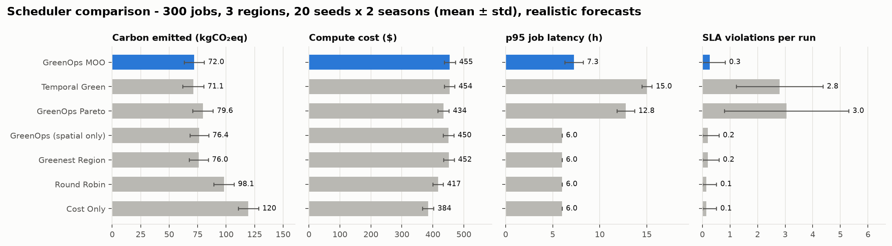

# GreenOps Cloud Orchestration

**Spatial and Temporal Demand Shifting for Carbon-Aware Workload Scheduling**

SANJEEVKUMAR K S (24MID0172) · NITHISH KUMAR (24MIC0032) · MUHAMMED FAHEEM K (24MID0158) — VIT Vellore

A multi-objective, carbon-aware scheduler for geo-distributed clouds, evaluated in a
SimPy discrete-event simulator driven by **real historical grid carbon-intensity data**.
For every job, the scheduler decides *where* (spatial shifting) and *when* (temporal
shifting) to run it. It trades off carbon emissions, compute cost and SLA risk, and
treats deadlines, budgets and data-residency rules as hard constraints.

The full write-up is in [`GreenOps_Final_Report.pdf`](GreenOps_Final_Report.pdf).

---

## Headline results

300 jobs, 3 regions (India, Germany, Norway), 20 seeds × 2 seasons (Jan + Jul 2024),
with the forecast error calibrated on real National Grid ESO forecasts (15 %):

| Scheduler | Carbon (kg) | Cost ($) | SLA violations / run | p95 latency (h) |
|---|---:|---:|---:|---:|
| Cost Only | 119.6 | 384 | 0.15 | 6.0 |
| Round Robin | 98.1 | 417 | 0.15 | 6.0 |
| Greenest Region | 76.0 | 452 | 0.20 | 6.0 |
| Temporal Green | 71.1 | 454 | 2.80 | 15.0 |
| **GreenOps MOO** | **72.0** | **455** | **0.28** | **7.3** |

* **−26.8 %** carbon vs Round Robin and **−5.3 %** vs Greenest Region (paired permutation test, p < 0.001), for +0.65 % cost.
* Gets within 1.2 % of Temporal Green's carbon, with **90 % fewer SLA violations** and **52 % lower p95 latency**.
* More robust to forecast error. From 0 % to 50 % error, Temporal Green's carbon rises 4.9 % and the MOO's 1.9 %. Above 30 % error the MOO is the greener of the two.
* Its advantage **grows with load**: −9.8 % vs Greenest Region at 2× load, while Temporal Green reaches 15 SLA violations per run.
* Most of the temporal benefit needs only 2–4 h of deferral. Longer windows add latency and little carbon reduction (the *practical limits*).
* The weight sweep traces a carbon–cost frontier with a hypervolume of 0.74–0.75, against 0.52 for all four baselines combined.
* Each decision takes about 0.1 ms, and runtime scales linearly (5,000 jobs simulate in under 0.5 s).



---

## Repository layout

```
data/
  fetch_carbon_traces.py         download + build historical traces (Energy-Charts, NG-ESO)
  carbon_traces/{india,germany,norway}.csv      controlled 24 h profiles (preliminary study)
  carbon_traces/historical/{winter,summer}_2024/*.csv   672 h hourly traces, 6 regions
  workload_traces/generate_workload.py          heterogeneous workload generator (CLI)
  workload_traces/workload_100.csv              100-job reference workload
sim/
  job.py        Job: resources, deadline, flexibility class, budget, carbon priority, locality
  region.py     Region: capacity, price, power model + PUE, carbon trace, run-window averaging
  forecast.py   CarbonForecaster: horizon-dependent, autocorrelated forecast error
  engine.py     CloudSimulator (SimPy): admission, queueing, deferral, re-planning, execution
schedulers/
  base.py               common interface + shared hard constraints
  round_robin.py        carbon-agnostic baseline
  cost_only.py          cheapest region
  greenest_region.py    greedy spatial-only
  temporal_green.py     carbon-greedy spatio-temporal (trusts forecast, no re-planning)
  carbon_aware_moo.py   GreenOps MOO (weighted-sum and Pareto/Tchebycheff modes)
metrics/collector.py    carbon, energy, cost, SLA violations + tardiness, latency p95/p99, region share
experiments/
  scenario.py           regions, traces, workloads, scheduler factory
  run_experiment.py     one scheduler, one workload, verbose decisions (CLI)
  comparison/run_all.py preliminary 5-job comparison
  evaluation.py         experiments E1-E7 (multi-seed, parallel)
  plots.py              figures
tests/                  50 unit + integration tests
demo.py                 one-command live demo (viva)
docs/dashboard.html     interactive results dashboard (offline)
notebooks/analysis.ipynb results exploration
results/evaluation/     all raw runs + summaries (CSV)
results/figures/        all figures (PNG)
```

---

## Running it

The virtual environment `greenops_env` already contains every dependency
(`pip install -r requirements.txt` to recreate it).

```powershell
# activate (PowerShell)
.\greenops_env\Scripts\Activate.ps1

# one-command live demo (pauses between steps)
python demo.py

# interactive dashboard: open docs/dashboard.html in a browser
# (rebuild it from the results with: python -m experiments.build_dashboard)

# tests
python -m unittest discover -s tests -t . -v

# one simulation with decision-by-decision output
python -m experiments.run_experiment
python -m experiments.run_experiment --scheduler temporal_green --period summer_2024 --forecast-error 0.15

# preliminary 5-job comparison
python -m experiments.comparison.run_all

# full evaluation (~1 min on 16 cores) + figures
python -m experiments.evaluation
python -m experiments.plots

# optional: re-download carbon data / regenerate workload
python data/fetch_carbon_traces.py
python data/workload_traces/generate_workload.py --jobs 100 --seed 42
```

---

## How the GreenOps scheduler decides

For each job and each candidate `(region r, start time s)`:

* **Hard constraints:** data locality, capacity, budget `cost ≤ max_cost`, and SLA `s + runtime ≤ deadline`. Strict jobs only get `s = now`.
* **Objectives:**
  * carbon `C = E_r · CI_forecast(r, s..s+runtime) · (1 + κ·σ(s−now))`
  * cost `K = cpu · runtime · price_r`
  * SLA risk `R = ((s−now)/(latest_start−now))²`
* **Weighted mode:** `score = w_c·p_job·C/C_max + w_k·K/K_max + w_r·R`, with defaults `w = 0.6/0.2/0.2`, `κ = 0.5`.
* **Pareto mode:** filter non-dominated candidates, then pick by weighted Tchebycheff distance to the ideal point.
* **Re-planning:** deferred jobs are re-planned every hour with a fresher forecast. Jobs that find no free capacity are queued, never dropped.

Default weights were selected on tuning seeds 100–104. All reported results use seeds 0–19.

## Data sources

| Region | Source | Mean CI winter / summer (g/kWh) |
|---|---|---|
| Germany, Norway, France, Poland | [Energy-Charts](https://api.energy-charts.info) generation mix × IPCC AR5 lifecycle factors | DE 353/331, NO 28/31, FR 52/29, PL 586/626 |
| Great Britain | [National Grid ESO Carbon Intensity API](https://carbonintensity.org.uk) (actual + forecast) | 159/113 |
| India | **modelled**, calibrated to CEA CO₂ Baseline Database (no free hourly API) | 708/633 |

## Limitations

The evaluation is simulation-based. India's trace is modelled rather than measured. Intensity is
production-based (imports are ignored), and the workloads are synthetic. Network transfer latency
and the energy cost of moving data are not modelled. See §6 of the report.
